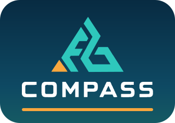

  

<b>A free tool for assessing children's fundamental motor skills.</b>

FG-COMPASS rates ten fundamental motor skills (five locomotor, five manipulative) with simple decision trees. Each skill is placed at one of four levels: **Initial, Emerging, Developing, Proficient**. It is built for PE teachers and coaches, clinicians and early childhood professionals, researchers, and parents and administrators.

| | |
|---|---|
| 🌐 **Website** | [fgcompass.com](https://fgcompass.com) |
| 📱 **FG-COMPASS Rater** (web app, nothing is saved) | [webapp.fgcompass.com](https://webapp.fgcompass.com) |
| 📘 **Manual** | [manual.fgcompass.com](https://manual.fgcompass.com) |

FG-COMPASS is free to use. If it helps your work, you can [support its development on GitHub Sponsors](https://github.com/sponsors/drfurtado). 💛
